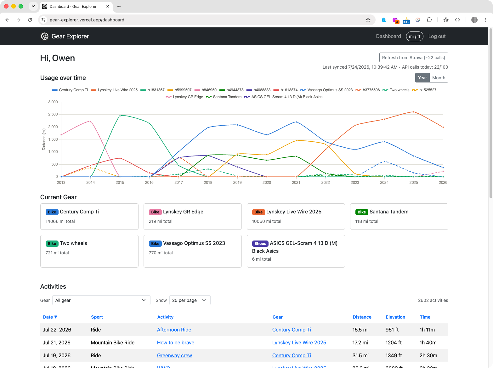

# Gear Explorer

https://gear-explorer.vercel.app

## Notes

To test this locally, change your “Authorization Callback Domain” in https://www.strava.com/settings/api to `developers.strava.com`

> The Authorization Callback Domain has to match wherever your app's /api/auth/callback route is actually reachable, and Strava only accepts a bare domain (no https://, no port, no path) — one value at a time. For local dev that should be `localhost` (as noted in this repo's IDEA.md/CLAUDE.md). If you deploy, you'd switch it to that deployment's real domain — Strava doesn't let you register both at once, so people typically either flip the setting when switching contexts or run two separate Strava API apps (one dev, one prod).

